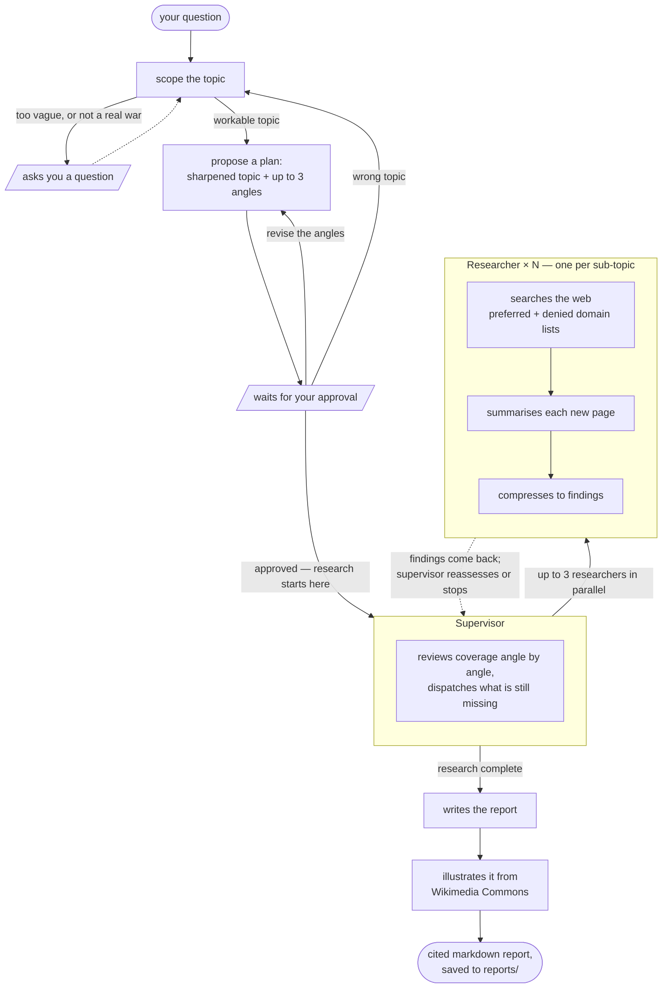

# War Research

[](https://github.com/fuhuan1991/War_Research/actions/workflows/ci.yml)
[](LICENSE)

[](https://langchain-ai.github.io/langgraphjs/)

**War Research** is a deep research agent for military history. Name a real battle, a
campaign, a whole war, from classical antiquity to the present, it works out what is worth
asking, agrees a plan with you, then runs a team of agents that research the approved angles in
parallel.

A run takes two to three minutes and returns a report of roughly 2,000 words: four to six
sections, every claim traceable to a linked source, and battle paintings, weapons, museum relics
and campaign maps pulled from Wikimedia Commons and credited in place.

The plan is the point. A research agent normally takes your prompt and starts spending; this one
shows you the sharpened topic and the angles it means to pursue, and waits. Revise them as often
as you like — it does not spend a cent until you approve.

> **Status:** a personal project, actively developed. Backlog in [TODO.md](TODO.md).

```
you › the battle of austerlitz

AI
**Proposed research plan**

**Topic:** The Battle of Austerlitz (2 December 1805): key decisions, turning points, and
their consequences during the engagement between Napoleon's French army and the combined
Russian and Austrian forces.

**Angles:**
1. What specific deception tactics did Napoleon employ in the days leading up to the Battle
   of Austerlitz, and how did these influence the Allied commanders' decisions on the morning
   of 2 December 1805?
2. How did the delayed arrival and deployment of Russian reinforcements under Bagration and
   Langeron affect the outcome of the battle …
3. What were the immediate strategic consequences for Austria and Russia following their
   defeat at Austerlitz …

Does this research plan look right? Approve it, or tell me what to change.

you › looks good, go ahead
```

Two minutes later:

```
  Report ready

  The Battle of Austerlitz (2 December 1805): Key Decisions, Turning Points, and Consequences

     1. Introduction
     2. Napoleon's Deception Tactics and Their Influence on Allied Decisions
     3. The Delayed Arrival and Deployment of Russian Reinforcements
     4. Immediate Strategic Consequences: Treaty of Pressburg and the Dissolution of the Third Coalition
     5. Conclusion
     6. Sources

  1,872 words · 28 sources · 6 images
  reports/2026-10-25-battle-austerlitz-2-december-1805-key-decisions-turning.md
```

## How it works



Three nested agents, built on [LangGraph.js](https://langchain-ai.github.io/langgraphjs/): a
**conversation** layer that holds everything until you approve a plan, a **supervisor** that
splits the plan into sub-topics and checks coverage, and **researchers** that search, read and
compress one sub-topic each. More in [Inside the pipeline](#inside-the-pipeline) below.

## What it can do

- **Any era of warfare.** Test runs cover the 1453 fall of Constantinople, the Song-Jin wars,
  Austerlitz and D-Day.
- **Narrows the topic with you.** Something too vague gets a concrete suggestion to accept or
  decline, not "what would you like to know?".
- **Plans before it spends.** You approve or revise the angles; nothing is searched until you
  say yes.
- **Researches up to three angles at once**, each by its own agent.
- **Curated sources.** A hand-built list of museums, university sourcebooks, national archives
  and learned societies ranks results; social media, self-publishing and alternate-history sites
  are excluded outright. See [preferredDomains.ts](src/tools/preferredDomains.ts) and
  [deniedDomains.ts](src/tools/deniedDomains.ts).
- **Cited reports**, 1,800–2,500 words over 4–6 sections, every source linked, saved to
  `reports/<date>-<topic-slug>.md`.
- **Illustrated from Wikimedia Commons** — paintings, weapons, museum relics, photographs and
  battle maps, 1–2 per section, each credited.
- **Optional self-contained HTML** with clickable citations, via `--html`.

## What it can't do

- **Runs cost real money.** Every model call hits the OpenAI API, every search hits Tavily, and
  one report is many calls across three layers.
- **Only real, battlefield wars.** Trade wars, culture wars, the war on drugs and cyber war are
  refused by design, with the nearest in-scope alternative offered instead.
- **One topic per CLI session.** The process exits after a report; `notes` appends, so a second
  run on the same thread would splice the first report's findings into the next.
- **Nothing persists.** Checkpoints are in memory (`MemorySaver`), so a restart loses the
  conversation. A database-backed checkpointer is a known TODO.
- **No web UI or HTTP API yet.** CLI and LangGraph Studio only — and note a paused graph is
  *resumed*, not re-invoked, so an HTTP surface needs a resume endpoint.
- **Bounded depth.** Three angles, five turns per researcher, four results per search. A
  well-sourced briefing, not a literature review.
- **LLM synthesis, not scholarship.** Citations are real and linked, but verify before relying
  on anything. Reports also skew more bullet-heavy than intended; a known gap.
- **OpenAI and Tavily only.** Every tier routes through `ChatOpenAI` ([src/model.ts](src/model.ts)).
- **Images are hotlinked**, so reports depend on Commons staying up.
- **`--html` auto-opens on macOS only.** Elsewhere the file is written; open it yourself.

## Quick start

Requires **Node 22+** and keys for OpenAI and Tavily.

**1. Install**

```bash
git clone <this repo>
cd War_Research
npm install
```

**2. Add a `.env` in the project root**

```bash
OPENAI_API_KEY=sk-...        # required — every model tier routes through ChatOpenAI
TAVILY_API_KEY=tvly-...      # required — web search

LANGSMITH_API_KEY=           # optional — tracing
LANGSMITH_TRACING=true
LANGSMITH_PROJECT=war-research
DOTENV_CONFIG_QUIET=true     # silences dotenv's startup banner
```

**3. Run it**

```bash
npm run cli
```

Missing keys are reported before anything else loads.

## Using the CLI

Type a topic to begin. A vague one gets a suggestion; a plan can be revised as often as you
like, and only revisions count against the round limit.

```
you › world war two

AI
World War II is a huge subject — want me to focus on the Pacific theater, or were you
thinking of the European front?

you › the european front, specifically the normandy landings

AI
**Proposed research plan**
…
Does this research plan look right? Approve it, or tell me what to change.

you › drop the third one, I'd rather know about the airborne drops
```

While the agents work, one status line reports the phase and elapsed time:

```
  ⠹ Researchers working…  2m 14s
```

### Flags

`npm` only forwards what follows a `--`:

| Flag | Effect |
| --- | --- |
| `npm run cli -- --verbose` | agent logs inline instead of in `cli.log` (`-v` also works) |
| `npm run cli -- --html` | also render the report as self-contained HTML and open it (macOS) |
| `npm run cli -- "the siege of Malta"` | skip the opening prompt |

`--html` is the exception: it is also read from `npm_config_html`, so `npm run cli --html` works.

### Commands

| Command | Effect |
| --- | --- |
| `/retry` | resume from the last checkpoint after an error |
| `/help` | list the commands |
| `/exit` | quit (Ctrl-C and Ctrl-D also work) |

### Output

The chat prints the report's outline, not its text — a few thousand words of markdown is the one
thing a terminal cannot show you. The report goes to `reports/<YYYY-MM-DD>-<topic-slug>.md`, with
`--html` writing a `.html` sibling. Nothing is ever overwritten: a name clash gets a `-2` suffix.
Agent logging goes to `cli.log` unless `--verbose` is set.

## Inside the pipeline

- **Every loop is bounded**, so a run always terminates: scoping gives up after a few nudges, the
  plan loop auto-accepts after enough rejections, and both research loops have turn limits. The
  constants are in [src/config.ts](src/config.ts), each with a note on why it holds its value.
- **Three model tiers**, picked per job rather than globally: a full model to reason, a nano model
  to choose a tool, a mini model for classification and page summaries.
- **The plan is the only handoff.** There is no separate research brief — the approved plan seeds
  the supervisor and fills the report prompt.
- **The graph pauses, it does not ask.** Both human-in-the-loop steps use LangGraph's
  `interrupt()`, so the run is resumed on the same thread rather than re-invoked. Anything built
  in front of this graph needs a resume endpoint.

For the annotated flow — all twelve LLM calls, the model tier behind each, and where the graph
pauses — see [docs/question-flow.md](docs/question-flow.md).

## Other ways to run it

**LangGraph Studio**, for stepping through the graph and inspecting state:

```bash
npm run dev
```

All three graphs are registered separately, so the supervisor or a single researcher can run on
its own.

**Trace harnesses**, which run one agent and write every message, state transition and per-call
cost to a folder under `traces/`:

```bash
npm run trace:researcher -- "a research topic"
npm run trace:supervisor -- --topic "..." --angle "..." --angle "..."
npm run trace:supervisor -- --markers   # print the call-attribution markers and exit; no API calls
```

Both make real API calls. `trace:supervisor` spawns researchers for real and is the most
expensive script here.

## Project layout

```
src/
  conversationAgent.ts   top-level graph: scoping, plan confirmation, report generation
  supervisorAgent.ts     splits the plan into sub-topics, reviews coverage
  researchAgent.ts       one per sub-topic: search → summarise → compress
  cli.ts                 the terminal chat
  config.ts              every limit and threshold, with its reasoning
  model.ts               the three model tiers
  plan.ts                the plan schema and its renderings
  reportOutput.ts        outline extraction, filename slugs, markdown → HTML
  images/                Wikimedia Commons client, picker and placement
  prompts/               one module per prompt
  states/                the three graph state schemas
  tools/                 Tavily search pipeline, domain lists
  trace/                 the tracing harnesses
docs/question-flow.md    annotated flow of the whole pipeline
tests/unit/              mocked, free to run
tests/eval/              real API calls and LLM-as-judge assertions; costs money
```

Further reading: [CLAUDE.md](CLAUDE.md) for the architecture and the decisions behind it,
[TODO.md](TODO.md) for the backlog, [conversation_plan.md](conversation_plan.md) for the design of
the scoping and confirmation loop.

## License

[MIT](LICENSE) — for the code. Not for what the agent produces: report text is model-synthesised
from third-party sources, and images are hotlinked from Wikimedia Commons under their own
licences, some CC BY-SA, which is why each carries its author and licence in the report.
