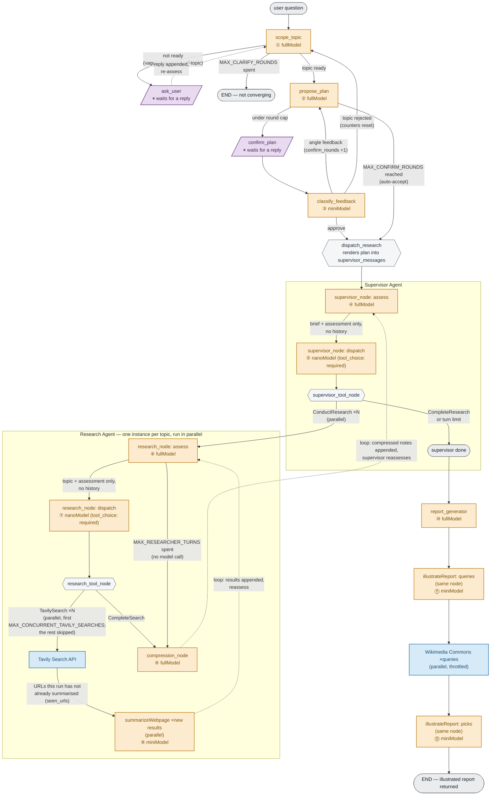

# War Research — Question Processing Flow Graph

## How a user question flows through the system

Each box is a step in the pipeline; arrows show the order actions happen in. Amber boxes are LLM calls (with their model tier), blue is the one external tool call, grey diamonds are routing/deterministic steps with no LLM involved, and purple parallelograms are `interrupt()` pauses — the graph stops there and waits for the user to resume the thread.

**Reading the pre-research loops:** nothing is researched until the user agrees to a plan. `scope_topic` judges the whole conversation, not just the last turn, and keeps nudging through `ask_user` until there is a workable topic — or until `MAX_CLARIFY_ROUNDS` is spent. It does *not* ask the user to confirm that they want research: a specific in-scope topic is taken as the request, and `confirm_plan` below is the consent gate, better informed because it shows the plan first. Only an explicit hold ("don't research this yet") stops a workable topic from being planned. `propose_plan` then turns that topic into at most `MAX_ANGLES_PER_PLAN` angles — fewer when the topic does not support more — and pauses at `confirm_plan` for a free-text reply, which `classify_feedback` reads as approve / revise-the-angles / wrong-topic. Angle feedback spends a confirmation round; approving costs nothing. After `MAX_CONFIRM_ROUNDS` rejections the next plan is auto-accepted rather than asking again.

**Reading the research loops:** the Supervisor Agent keeps assessing → dispatching → routing until it calls `CompleteResearch` (or hits its turn limit); each `ConductResearch` call spins up a parallel Research Agent instance, which itself loops assess → dispatch → search → summarize until it calls `CompleteSearch` (or, like the supervisor, hits its turn limit — checked at the top of `research_node`, before either model is called), then compresses its findings and hands them back to the supervisor for the next reassessment round.

**Reading the search layer:** three mechanisms sit on the `research_tool_node` → Tavily → `summarizeWebpage` path, and none of them is visible from the node names. First, the fan-out is *capped*: `research_tool_node` takes only the first `MAX_CONCURRENT_TAVILY_SEARCHES` calls and answers the rest with a synthetic `<Search skipped: concurrent search limit reached>` message, because `nanoModel` decides how many calls to emit and nothing else bounds it. Second, step ⑧ runs over *new* results only. A URL already summarised earlier in the same researcher run is skipped and reported separately as omitted; the `seen_urls` channel carries the set across turns, and one shared `Set` within a turn stops two parallel searches from both summarising a page they both returned. Third, ⑧ degrades rather than fails: an unparsable or failed `miniModel` call falls back to the first 1,000 characters of the raw page, labelled as a fragment so the researcher does not read it as a summary. Details in `src/tools/tavilySearch.ts`.

**Reading the dispatch calls (⑤ and ⑦):** neither dispatch model is given the message history — only the constant brief (or topic) and the assessment that precedes it. The assessment already states the decision and names the sub-topics or the next query, so the history buys the dispatch model nothing while being charged for on every turn, and by that point the history contains whole researcher reports. A traced run measured ⑤ receiving 14,163 input tokens to emit the 11 that name `CompleteResearch`. The consequence to keep in mind when editing the prompts: a dispatch model cannot see what earlier turns already dispatched, so any rule about avoiding redundant work belongs in the assessment prompt, which does read the history. See the note at the top of `src/prompts/supervisorDispatchingPrompt.ts`.

**Reading the illustration pass:** steps ⑪ and ⑫ are *not* a node of their own — they run inside `report_generator`, after its `fullModel` call has returned the report text. That is deliberate: the pass keys off the report's real `##` headings, and the report prompt lets the model structure its sections however it likes, so the headings cannot be predicted from `plan`. Query writing sees the research `notes`, which is what lets a section asking "what was the secret weapon at X" be illustrated with a picture of the weapon the findings actually identified. The picking call returns indices into a catalogue the code fetched — never URLs. The whole pass is best-effort: every failure path returns the unillustrated report, so nothing here can cost a run its output. Details in `src/images/illustrate.ts`.

**Where the plan ends up:** `dispatch_research` is the only seam between the two halves. It renders the confirmed `plan` into the single `HumanMessage` that seeds `supervisor_messages`, and `report_generator` renders the same plan into its prompt. There is no separate `research_brief` — the plan *is* the brief.
